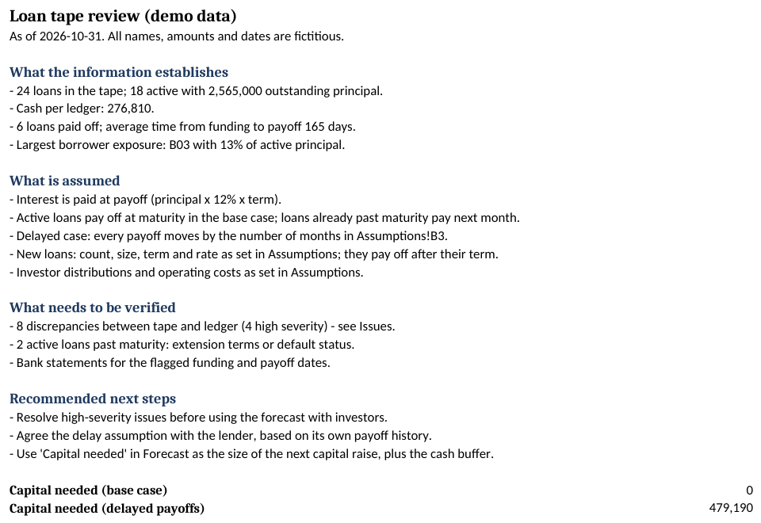
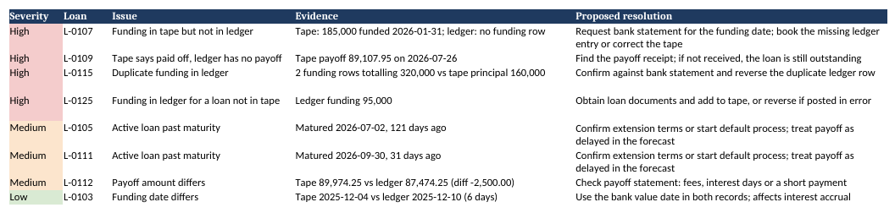
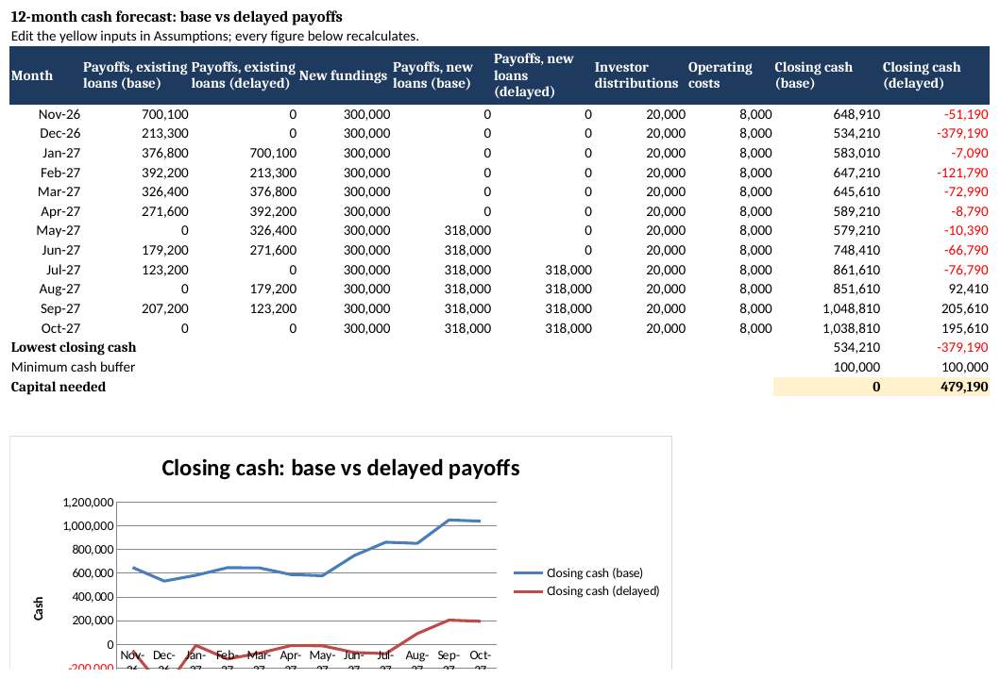

# Loan tape reconciliation and cash forecast (private credit demo)

A small review toolkit for a short-term real estate lender: it reconciles the loan tape against the capital ledger, lists every discrepancy with a proposed resolution, summarises the portfolio and builds a 12-month cash forecast that shows how much capital is needed if payoffs are delayed.

> Demo data only. The lender, borrowers, counties, amounts and dates are fictitious. The demo lender finances investors who buy properties at foreclosure auctions.



## What it produces

`output/Loan_Tape_Review.xlsx`, with one sheet per question:

| Sheet | Answers |
|---|---|
| Summary | What the data establishes, what is assumed, what needs to be verified, recommended next steps, and the capital needed |
| Issues | Every discrepancy between tape and ledger, with severity, evidence and a proposed resolution |
| Reconciliation | One row per loan: principal and payoff in the tape vs the ledger |
| Portfolio | Concentration by borrower, loans past maturity, days from funding to payoff |
| Assumptions | Forecast inputs in yellow cells (payoff delay, new loans, distributions, costs, cash buffer) |
| Loans | Active loans with expected and delayed payoff month, calculated by formula |
| Forecast | 12-month cash forecast, base vs delayed payoffs, lowest cash and capital needed, with a chart |

The forecast is built with Excel formulas, so changing an assumption (for example the payoff delay from 2 to 3 months) recalculates the whole sheet.

## What the reconciliation checks

- Funding in the tape but missing from the ledger, and the reverse
- Duplicate funding rows
- Funding amount or date differences (dates tolerate 3 days)
- Loans marked paid off with no payoff in the ledger
- Payoff amount differences
- Active loans past maturity

The demo data contains one example of each, planted on purpose:



## Cash forecast

With 2 new loans a month and payoffs on time, the demo lender never drops below its cash buffer. If every payoff slips by 2 months, cash goes negative in the first month and the lender needs about 479,000 of additional capital.



## Run it

Requires Python 3.10+.

```
pip install -r requirements.txt
python scripts/make_demo_data.py     # writes data/loan_tape.csv and data/capital_ledger.csv
python scripts/reconcile.py          # writes output/Loan_Tape_Review.xlsx
```

To use real data, replace the two CSV files with the same columns and run `reconcile.py --as-of YYYY-MM-DD`.

| File | Columns |
|---|---|
| `data/loan_tape.csv` | loan_id, borrower_id, county, auction_date, funding_date, principal, annual_rate, term_months, maturity_date, status, payoff_date, payoff_amount |
| `data/capital_ledger.csv` | date, type (Funding, Payoff, Investor capital in, Investor distribution, Operating costs), loan_id, amount (inflows positive, outflows negative) |

## Data handling

Real loan tapes contain borrower information. This toolkit runs locally and sends nothing anywhere; with real data, keep the files on the client's systems and follow the agreed confidentiality and data-protection rules.

## Author

Rodrigo Matoso: court-appointed real estate appraiser and broker (Brazil), former corporate relationship manager at HSBC, building analysis tools with AI-assisted coding.

## License

MIT
